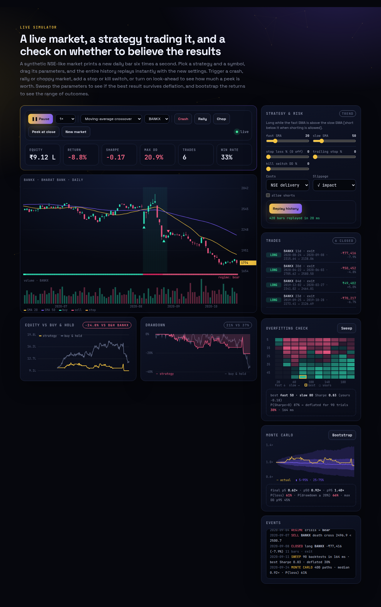
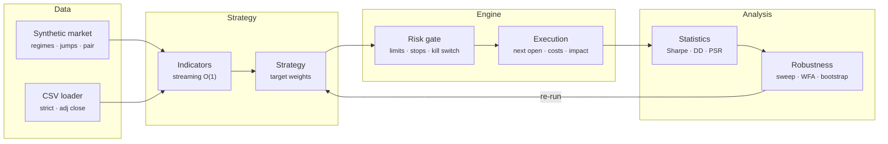
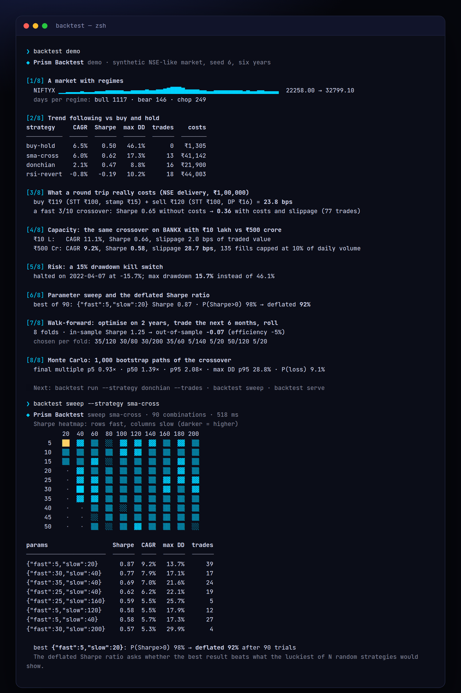
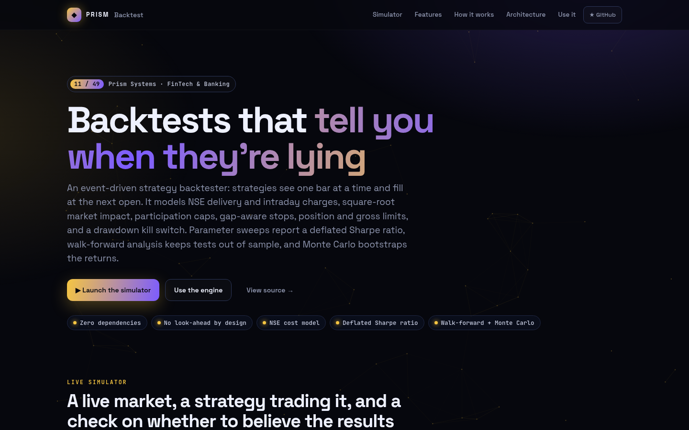
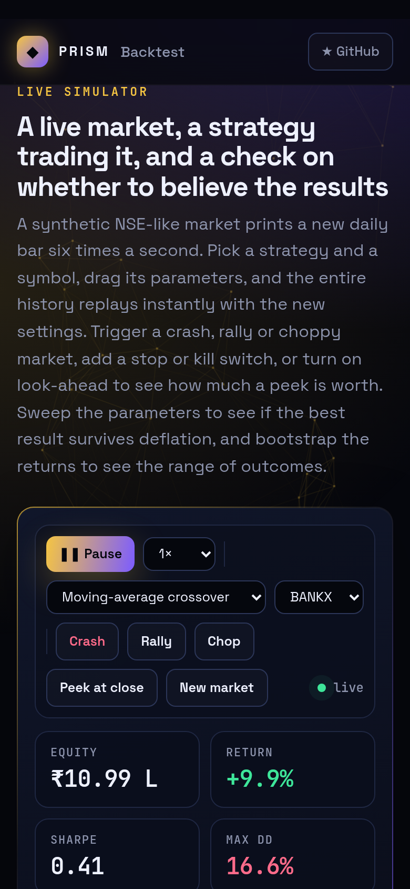

<!-- Prism Systems 11/49 -->
<p align="center">
  
</p>

<p align="center">
  
</p>

<p align="center">
  <a href="https://github.com/krishyaa06/prism-backtest/actions/workflows/ci.yml"></a>
  <a href="https://krishyaa06.github.io/prism-backtest/"></a>
  
  
  
  <a href="LICENSE"></a>
</p>

<p align="center">
  <a href="https://krishyaa06.github.io/prism-backtest/"><b>Live simulator</b></a> ·
  <a href="docs/ARCHITECTURE.md"><b>Architecture</b></a> ·
  <a href="docs/USAGE.md"><b>Docs</b></a> ·
  <a href="#-quick-start"><b>Quick start</b></a>
</p>

<p align="center">
  <a href="https://krishyaa06.github.io/prism-backtest/"></a>
</p>


## ⚡ Overview

Most backtests look better than the strategy will ever trade. They peek at the close they trade on, ignore STT and impact, assume unlimited liquidity and report the best of a hundred parameter sets as if it were the only one tried. Prism Backtest is built to make those mistakes hard to make by accident, and easy to measure on purpose. The engine is event-driven and incremental, the costs are modelled to the rupee for Indian equities, and every result can be checked for overfitting with a deflated Sharpe ratio, walk-forward analysis and a bootstrap.

## ✨ Features

| | Feature | Details |
| :-: | --- | --- |
| ⏵ | **No look-ahead by construction** | Bars are fed one at a time, so `ctx.hist()` can only return the past. Orders decided on bar i fill at bar i+1's open. Same-bar close fills exist only as an explicit opt-in (`fill: "close"`), so you can measure the bias. |
| ₹ | **Indian cost model** | NSE delivery and intraday schedules: brokerage (with a ₹20 cap for intraday), STT, exchange transaction charges, the SEBI fee, buy-side stamp duty, GST on fees and the DP charge on delivery sells. Flat-bps and zero-cost options are included too. |
| √ | **Market impact + capacity** | Half-spread plus k·σ·√(qty / volume) square-root impact, using each symbol's own rolling volatility. Fills are capped at 10% of a bar's volume, so you can watch a strategy stop working as the account grows. |
| ⛔ | **Risk between strategy and market** | Position and gross exposure limits scale requests down, shorts can be disabled, and the engine can set fixed or trailing stops. Stops fill at the stop price, or at the open when price gaps through them. A drawdown kill switch liquidates and halts trading. |
| ∑ | **Seven strategies** | SMA crossover, RSI mean reversion with a trend filter, Bollinger reversion, Donchian breakout with ATR risk sizing, cross-sectional momentum with an absolute filter, rolling-OLS pairs trading, and buy and hold. Custom strategies need only `onBar(ctx)`. |
| σ | **Statistics that matter** | CAGR, volatility, Sharpe, Sortino, Calmar, maximum drawdown and its duration, historical VaR and CVaR, beta and alpha, win rate, profit factor, expectancy, MAE and MFE, exposure, turnover, costs and monthly returns. |
| ⚖ | **Overfitting checks** | The probabilistic Sharpe ratio corrects for sample length, skew and fat tails. The deflated Sharpe ratio compares the best sweep result with what the luckiest of N random strategies would show. Walk-forward analysis reports in-sample against out-of-sample efficiency. |
| ⚡ | **CLI + HTTP API** | `demo`, `run`, `sweep` (with an ASCII heatmap), `walkforward`, `montecarlo`, `costs`, `strategies`, `data`, `bench` and `serve`. The API exposes `POST /v1/backtest`, `/v1/sweep`, `/v1/walkforward` and `/v1/montecarlo`, with synthetic or uploaded CSV data. |

## 🏗️ Architecture



### How it works

1. **Feed** — Each date's bars are appended to per-symbol history. Rolling volatility is updated for the impact model, and symbols missing on a date carry their last close.
2. **Fill** — Orders from yesterday's decision fill at today's open after slippage and the participation cap. Stops are then checked against today's range and are gap-aware.
3. **Mark** — Positions are marked at the close, short borrow and optional cash interest are charged, trailing stops ratchet, and each trade's excursions are tracked.
4. **Decide** — The strategy sees bars up to today and states target weights. The engine clamps them to the position and gross limits, rejects disallowed shorts, applies a rebalance band and queues the difference as orders.
5. **Judge** — Equity, drawdown and trades become statistics. Sweeps, walk-forward runs and bootstraps then ask whether the result would survive outside this one sample.

More detail in [docs/ARCHITECTURE.md](docs/ARCHITECTURE.md).

## 🚀 Quick Start

**Try it in the browser:** [https://krishyaa06.github.io/prism-backtest/](https://krishyaa06.github.io/prism-backtest/), no install needed.

```bash
# CLI, no install
npx github:krishyaa06/prism-backtest --help

# add the engine to a project
npm install github:krishyaa06/prism-backtest
```

### JavaScript API

```js
import { backtest, sweep, walkForward, monteCarlo, generate, parseCSV, GRIDS } from "prism-backtest";

const data = { BANKX: generate({ seed: 6, years: 6 }).BANKX };        // or { RELIANCE: parseCSV(fs.readFileSync("RELIANCE.csv", "utf8")) }

const r = backtest(data, {
  strategy: "sma-cross", params: { fast: 20, slow: 50 },
  cash: 10_00_000, costs: "india-delivery",                          // STT, stamp duty, exchange + SEBI fees, GST, DP charge
  slippage: { model: "sqrt", k: 0.6, spreadBps: 2 },                 // half spread + square-root impact
  risk: { stopLoss: 0.08, maxPos: 1, ddHalt: 0.25 },                 // gap-aware stop, kill switch at -25%
});
r.metrics;   // { cagr, sharpe, sortino, maxDD, calmar, var95, winRate, profitFactor, psr, fees, slippage, ... }
r.trades;    // [{ sym, side, entryD, exitD, entry, exit, pnl, ret, mae, mfe, exitTag }]

const s = sweep(data, { strategy: "sma-cross", grid: GRIDS["sma-cross"] });
s.best; s.dsr;                                                       // deflated Sharpe after s.trials combinations

const wf = walkForward(data, { strategy: "sma-cross", grid: GRIDS["sma-cross"], train: 504, test: 126 });
wf.isSharpe; wf.oos.sharpe; wf.efficiency;                           // in-sample vs out-of-sample

const mc = monteCarlo(r, { runs: 1000, block: 10 });
mc.final[0.05]; mc.maxDD[0.95]; mc.pLoss;

// your own strategy: state target weights, the engine does the rest
const myStrategy = { onBar(ctx) { const c = ctx.close("BANKX"), c20 = ctx.close("BANKX", 20); if (c20) ctx.target("BANKX", c > c20 ? 1 : 0); } };
backtest(data, { strategy: myStrategy });
```

| Export | What it does |
|---|---|
| `backtest(data, opts)` | Run over `{ SYM: bar[] }` and return `{ dates, equity, bench, dd, gross, trades, fills, open, metrics, monthly }` |
| `new Backtest({ strategy, params, cash, costs, slippage, fill, maxVolPct, risk, benchmark, rf, cashRate, borrowBps, startAt, lot })` | Incremental engine: `.feed(date, bars)`, `.result()`, `.on(fn)`, `.resume()` |
| Events | `signal`, `fill`, `trade`, `stop`, `partial`, `reject`, `clamp`, `cancel`, `halt`, `resume` |
| Strategy `ctx` | `i`, `d`, `syms`, `equity`, `cash`, `canShort`, `bar(s)`, `close(s, k)`, `hist(s, n)`, `pos(s)`, `weight(s)`, `stops(s)`, `target(s, w, { stop, tag })`, `flat(s)`, `order(s, qty, { limit })`, `note(s, text, kind)` |
| `STRATEGIES` · `resolve(name, params)` · `StrategyError` | Built-ins with parameter specs and validation |
| `sweep(data, { strategy, grid, metric })` · `walkForward(data, { strategy, grid, train, test })` · `monteCarlo(result, { runs, block })` · `GRIDS` · `range` | Robustness |
| `stats(equity, { trades, bench, rf })` · `psr` · `dsr` · `expectedMaxSharpe` · `drawdowns` · `monthly` · `bootstrap` | Statistics |
| `charges(side, qty, price, schedule)` · `slip(side, qty, price, model, { vol, volume })` · `COSTS` | Costs and slippage |
| `SMA` `EMA` `RSI` `ATR` `Bollinger` `Donchian` `MACD` `ROC` `RollingOLS` `Stdev` | Streaming indicators (+ array versions) |
| `Market` · `generate` · `parseCSV` · `toCSV` · `UNIVERSE` · `REGIMES` | Data |
| `createServer()` from `src/node/server.js` | HTTP API |

### CLI

```bash
$ npx github:krishyaa06/prism-backtest demo
$ npx github:krishyaa06/prism-backtest run --strategy donchian --symbols BANKX --trades
$ npx github:krishyaa06/prism-backtest run --strategy rsi-revert --csv RELIANCE.csv --costs india-delivery
$ npx github:krishyaa06/prism-backtest sweep --strategy sma-cross
$ npx github:krishyaa06/prism-backtest walkforward --strategy sma-cross --train 504 --test 126
$ npx github:krishyaa06/prism-backtest montecarlo --runs 2000
$ npx github:krishyaa06/prism-backtest costs --value 100000
$ npx github:krishyaa06/prism-backtest serve --port 8789
```

<p align="center"></p>

| Command | Description |
|---|---|
| `backtest demo` | Eight steps: regimes, trend vs buy and hold, the cost of a round trip, capacity, kill switch, sweep + deflated Sharpe, walk-forward, Monte Carlo |
| `backtest run [--strategy --<param> N] [--symbols A,B \\| --csv file.csv[:SYM]] [--costs --slippage sqrt\\|bps:5\\|none --fill --stop --trail --ddhalt --short] [--trades] [--json]` | One backtest with a full report |
| `backtest sweep [--strategy] [--grid fast=5:50:5,slow=20:200:20]` | Grid search, heatmap, top results, PSR and deflated Sharpe |
| `backtest walkforward [--strategy --train 504 --test 126]` | Rolling out-of-sample test with chosen parameters per fold |
| `backtest montecarlo [--runs 1000 --block 10]` | Block bootstrap percentiles of final equity, CAGR and drawdown |
| `backtest costs [--value 100000 --schedule india-delivery]` | Breakdown of one round trip |
| `backtest strategies` · `backtest data [--out data/]` · `backtest bench` · `backtest serve [--port 8789]` | Reference, synthetic CSVs, throughput, HTTP API |

## 📸 Screenshots

<table>
  <tr>
    <td width="68%"></td>
    <td width="32%"></td>
  </tr>
</table>

## 🧠 Design Decisions

- **Incremental by design.** `feed()` takes one date at a time, so look-ahead isn't something you have to remember to avoid: the data simply isn't there yet. The same engine powers the batch API and the live simulator.
- **Targets, not orders.** Strategies state the weight they want and the engine turns that into orders against current position and pending orders, so partial fills, halts and warm-up are handled without strategy code. A 10% rebalance band prevents churn.
- **Costs reserved up front.** Target sizes keep a 0.5% buffer so a 100% target never overdraws cash once charges are added.
- **Gap-aware stops.** A stop fills at the stop price only if the bar trades through it. If the open is already beyond it, the fill is at the open, which is where many backtests are too optimistic.
- **Stopped out means out.** Strategies can read `ctx.stops(sym)` and the crossover sits out until the next cross instead of buying back the next morning.
- **Symbol streams are independent.** Each synthetic symbol has its own seeded random stream on top of a shared market factor, so a symbol's path doesn't change when you add others to the universe.
- **Honest robustness.** Walk-forward picks parameters on training data only and warms indicators on data before the test window without trading. The deflated Sharpe uses the variance of the Sharpe ratios actually observed in the sweep.

## 🏭 Production Notes

The engine, costs and statistics are complete and tested. Before trusting it with real money you would also want:

- Real, survivorship-free data with corporate actions. The CSV loader adjusts OHLC by adjusted close, but delistings, symbol changes and index membership history need a proper data vendor.
- Exchange-specific details: circuit limits, T+1 settlement and margin for intraday or F&O, lot sizes for derivatives, auction sessions, and current brokerage and tax rates (STT and stamp duty change by budget).
- Intraday bars or tick data for strategies whose edge lives inside the day, and a queue-position-aware fill model for limit orders.
- Tax on realised gains (STCG / LTCG) for after-tax returns, and cash interest set to your real sweep rate (`cashRate`).
- Paper trading against a live broker API before going live, because a backtest is evidence, not proof.

## 📁 Project Structure

```text
prism-backtest/
├── assets/
│   └── logo.svg
├── bin/
│   └── backtest.js
├── css/
│   └── app.css
├── docs/
│   ├── ARCHITECTURE.md
│   └── USAGE.md
├── examples/
│   └── SAMPLE.csv
├── js/
│   └── app.js
├── src/
│   ├── lib/
│   │   ├── cli.js
│   │   └── rng.js
│   ├── node/
│   │   └── server.js
│   ├── costs.js
│   ├── data.js
│   ├── engine.js
│   ├── index.js
│   ├── indicators.js
│   ├── metrics.js
│   ├── optimize.js
│   └── strategies.js
├── test/
│   └── backtest.test.js
├── .gitignore
├── LICENSE
├── README.md
├── index.html
└── package.json
```

## 🧪 Tests

```bash
npm test
```

The test suite uses the built-in `node:test` runner, so there is nothing to install. CI runs it on Node 20 and 22.

## 🗺️ Roadmap

- [ ] Intraday bars and limit-order queue modelling
- [ ] F&O: futures roll, lot sizes, margin
- [ ] STCG / LTCG after-tax returns
- [ ] Combinatorial purged cross-validation (PBO)

## 🤝 Contributing

1. Fork the repo and create a branch: `git checkout -b feat/my-idea`
2. Make your change in `src/` and add a test in `test/`
3. Run `npm test`, then open a Pull Request

## 🔷 Part of Prism Systems

**Prism Backtest** is system **11 of 49** in **Prism Systems**, a series of open-source reference implementations of large-scale infrastructure by [Prism Protocol](https://dc.gg/prismprotocol). Each one ships a real engine, a CLI and a live simulator, all with zero dependencies.

## 👤 Author

<table>
  <tr>
    <td align="center">
      <a href="https://github.com/krishyaa06"><br><b>Soumya Bhandare</b></a><br>
      <sub>Founder @ Prism Protocol</sub>
    </td>
    <td>
      <a href="https://dc.gg/prismprotocol"></a><br>
      <a href="https://instagram.com/prism_protocol_"></a><br>
      <a href="https://x.com/krishyaa06"></a>
    </td>
  </tr>
</table>

## 📄 License

Released under the [MIT License](LICENSE).

<p align="center">
  <b>If this helped you learn something, consider giving it a ⭐</b><br>
  <sub>"Build. Create. Compete." · Made with ⚡ by Prism Protocol</sub>
</p>


