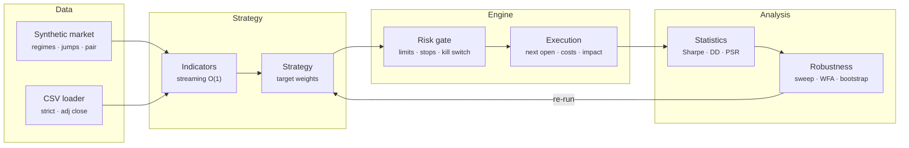

# Prism Backtest — Architecture

Most backtests look better than the strategy will ever trade. They peek at the close they trade on, ignore STT and impact, assume unlimited liquidity and report the best of a hundred parameter sets as if it were the only one tried. Prism Backtest is built to make those mistakes hard to make by accident, and easy to measure on purpose. The engine is event-driven and incremental, the costs are modelled to the rupee for Indian equities, and every result can be checked for overfitting with a deflated Sharpe ratio, walk-forward analysis and a bootstrap.

## System diagram

## How it works

1. **Feed** — Each date's bars are appended to per-symbol history. Rolling volatility is updated for the impact model, and symbols missing on a date carry their last close.
2. **Fill** — Orders from yesterday's decision fill at today's open after slippage and the participation cap. Stops are then checked against today's range and are gap-aware.
3. **Mark** — Positions are marked at the close, short borrow and optional cash interest are charged, trailing stops ratchet, and each trade's excursions are tracked.
4. **Decide** — The strategy sees bars up to today and states target weights. The engine clamps them to the position and gross limits, rejects disallowed shorts, applies a rebalance band and queues the difference as orders.
5. **Judge** — Equity, drawdown and trades become statistics. Sweeps, walk-forward runs and bootstraps then ask whether the result would survive outside this one sample.

## Design decisions

- **Incremental by design.** `feed()` takes one date at a time, so look-ahead isn't something you have to remember to avoid: the data simply isn't there yet. The same engine powers the batch API and the live simulator.
- **Targets, not orders.** Strategies state the weight they want and the engine turns that into orders against current position and pending orders, so partial fills, halts and warm-up are handled without strategy code. A 10% rebalance band prevents churn.
- **Costs reserved up front.** Target sizes keep a 0.5% buffer so a 100% target never overdraws cash once charges are added.
- **Gap-aware stops.** A stop fills at the stop price only if the bar trades through it. If the open is already beyond it, the fill is at the open, which is where many backtests are too optimistic.
- **Stopped out means out.** Strategies can read `ctx.stops(sym)` and the crossover sits out until the next cross instead of buying back the next morning.
- **Symbol streams are independent.** Each synthetic symbol has its own seeded random stream on top of a shared market factor, so a symbol's path doesn't change when you add others to the universe.
- **Honest robustness.** Walk-forward picks parameters on training data only and warms indicators on data before the test window without trading. The deflated Sharpe uses the variance of the Sharpe ratios actually observed in the sweep.

## Production notes

The engine, costs and statistics are complete and tested. Before trusting it with real money you would also want:

- Real, survivorship-free data with corporate actions. The CSV loader adjusts OHLC by adjusted close, but delistings, symbol changes and index membership history need a proper data vendor.
- Exchange-specific details: circuit limits, T+1 settlement and margin for intraday or F&O, lot sizes for derivatives, auction sessions, and current brokerage and tax rates (STT and stamp duty change by budget).
- Intraday bars or tick data for strategies whose edge lives inside the day, and a queue-position-aware fill model for limit orders.
- Tax on realised gains (STCG / LTCG) for after-tax returns, and cash interest set to your real sweep rate (`cashRate`).
- Paper trading against a live broker API before going live, because a backtest is evidence, not proof.
